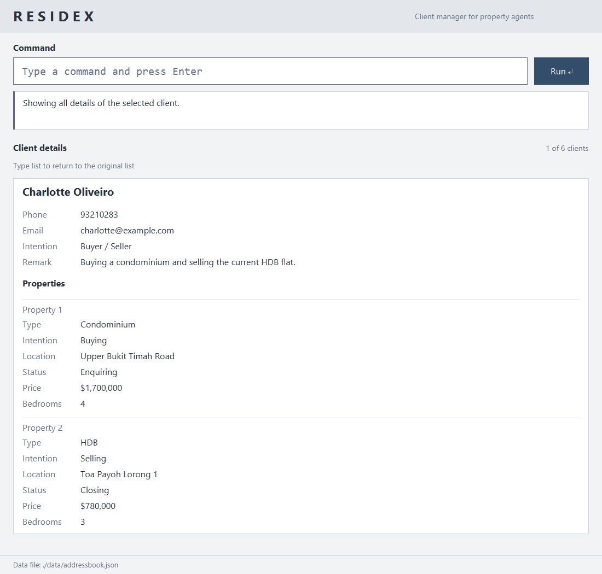
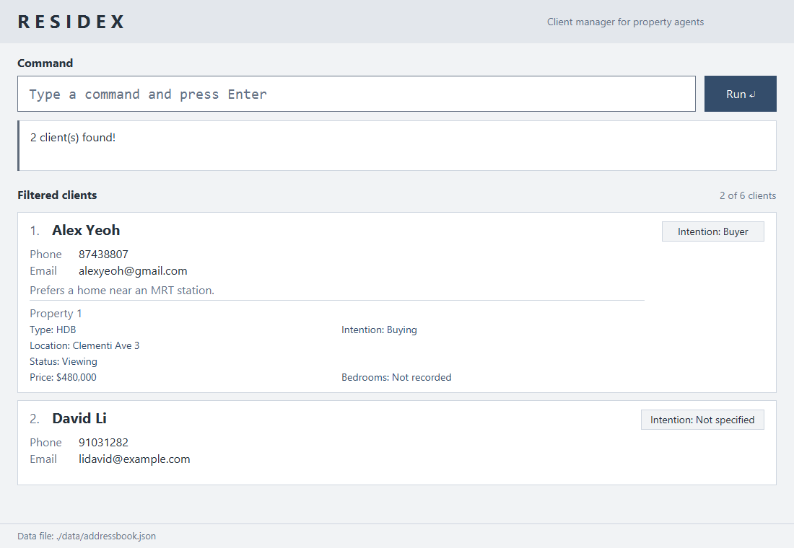

# RESIDEX User Guide

RESIDEX is a **desktop application for property agents managing buyers and sellers, optimized for use through a Command Line Interface (CLI)** while retaining the benefits of a Graphical User Interface (GUI). If you type quickly, RESIDEX can help you manage clients faster than traditional GUI applications.

<!-- * Table of Contents -->
<page-nav-print />

--------------------------------------------------------------------------------------------------------------------

## Quick start

1. Ensure that Java `25` or later is installed on your computer. 
   **Mac users:** Ensure you have the precise JDK version prescribed [here](https://se-education.org/guides/tutorials/javaInstallationMac.html).

1. Download the latest `.jar` file from [here](https://github.com/AY2627S1-CS2103T-W11-4/tp/releases).

1. Copy the file to the folder you want to use as the _home folder_ for RESIDEX.

1. Open a terminal, `cd` to the folder containing the JAR file, and run `java -jar Residex.jar`. 
   Launch RESIDEX from the terminal like this rather than by double-clicking the JAR file. Use a folder that you are allowed
   to write to, because RESIDEX creates a `data` folder next to where you run it to save your clients. 
   A GUI similar to the one below should appear in a few seconds. Note how the app contains some sample data. 
   

   This screenshot uses the bundled sample clients with example remarks and property statuses.
   Fresh sample data includes remarks for Alex Yeoh and Charlotte Oliveiro. Existing saved remarks are unchanged.
   <!-- Codex assisted Brendan-Lim with the fresh-sample search documentation. -->
   With fresh sample data, `find s/viewing` returns Alex Yeoh; `find s/unspecified` returns Bernice Yu and Charlotte Oliveiro.

1. Type a command in the command box and press Enter to execute it. For example, type **`help`** and press Enter to open the help window. 
   Some example commands you can try:

   * `list` : Lists all clients.

   * `view 1` : Shows all fields of the first displayed client. Use `list` to return to all clients.

   * `add n/John Doe p/98765432 e/johnd@example.com` : Adds a client named `John Doe` with intention Not specified.

   * `delete 3` : Deletes the 3rd client shown in the current list.

   * `exit` : Exits the app.

1. Refer to the [Features](#features) section below for details of each command.

--------------------------------------------------------------------------------------------------------------------

## Reading the interface

* **Command:** Type a command and press Enter or click **Run**. The feedback box below shows its result or an input error.
* **Client list:** The heading is **All clients**, **Filtered clients** or **Client details**.
  The count shows how many clients are displayed out of all stored clients.
* **Client cards:** Each card shows its displayed index, name, phone, email, derived intention,
  any remark and numbered property summaries. A property summary shows type, intention, location,
  optional price and transaction status. Clients without properties have intention **Not specified**.
* **Prices:** Monetary amounts belong to property entries. There is no client budget amount on the right of a card;
  the badge on the right shows the derived intention.
* **Full details:** `view INDEX` replaces the list with the selected client's details and a reminder to enter `list`.
  Long values wrap, and the list area scrolls when needed.
* **Data location:** The footer shows where the client data file is stored.

## Features

<box type="info" seamless>

**Notes about the command format:** 

* Command words are case-insensitive; `ADDP` and `addp` run the same command.
  Prefixes for property commands are also case-insensitive, while existing client commands retain their documented field rules.

* Words in `UPPER_CASE` are the parameters to be supplied by the user. 
  For example, in `add n/NAME`, replace `NAME` with a value such as `John Doe`.

* Items in square brackets are optional. 
  For example, `addp 1 t/HDB i/Buying l/Clementi [pr/PRICE]` can include `pr/800000` or omit the price.

* Parameters can be in any order. 
  For example, if the command specifies `n/NAME p/PHONE_NUMBER`, `p/PHONE_NUMBER n/NAME` is also acceptable.

* Extraneous parameters for commands that take no parameters, such as `help`, `list`, `undo`, `redo` and `exit`, are ignored. 
  For example, `help 123` is interpreted as `help`.

* If you are using a PDF version of this document, be careful when copying and pasting commands that span multiple lines as space characters surrounding line-breaks may be omitted when copied over to the application.
</box>

### Viewing help: `help`

Opens a separate, resizable window containing the command reference. Each command has a card showing its
purpose, format, parameter rules and examples. It uses the same light styling as the main window.
The command reference is available without an internet connection.

Format: `help`

* Scroll through the cards using the mouse wheel or scrollbar. Resize the window for more space.
* Click **Copy** beside an example to copy that command, then paste it into the main command box and adjust its
  values before pressing Enter. Copying does not execute the example.
  The button shows **Copied** on success. If it shows **Failed**, click it again to retry.
  Its accessible text also includes the result and identifies the example.
  You can reach the buttons with Tab and activate them with Space.
* You can also open help by pressing `F1`. Opening help again restores the existing window if it is minimised,
  brings it to the front and focuses it. Its size and scroll position are kept.
* Click **Copy URL** in the footer to copy the RESIDEX User Guide link for further information.
  Opening the online guide requires an internet connection.

### Adding a client: `add`

Adds a client to RESIDEX.

Format: `add n/NAME p/PHONE_NUMBER e/EMAIL`

Phone numbers must contain 3 to 15 digits only. The same rule applies when editing a client's phone number.
An unexpected field such as `x/foo` is rejected with `Unexpected parameter: x/foo` in both `add` and `edit`.

A client is a duplicate only when both their name and phone number match an existing client.
Name matching ignores capitalisation, surrounding spaces and repeated spaces between words.
For example, `Alice Tan` and `ALICE   TAN` match when their phone numbers are the same.
Phone input is trimmed, then compared digit for digit, including leading zeros.
Clients may share a name if their phone numbers differ, or share a phone number if their names differ.
Different email addresses, intentions or remarks do not make an otherwise duplicate client distinct.
If an add or edit would create a duplicate, the error identifies the existing client's stored name and phone number and explains how names are matched.
The conflicting client may be outside the current search results.
A rejected command leaves all client information unchanged.

Client intention is calculated from the client's recorded properties and cannot be set directly.
New clients have no properties, so their intention is **Not specified**.
Supplying `i/` to client `add` or `edit` is rejected, including `i/Buyer`, `i/Seller` and `i/Both`.
Use the property commands to change the properties that determine the role.

| Recorded property intentions | Client intention shown |
| --- | --- |
| No properties | Not specified |
| One or more Buying properties, no Selling properties | Buyer |
| One or more Selling properties, no Buying properties | Seller |
| At least one of each direction | Buyer / Seller |

The role updates automatically after `addp`, `editp` or `delp`.
Property order and repeated entries do not affect which role is derived.

Client budgets are no longer stored. Both `add` and `edit` reject the removed `b/` option,
including uppercase `B/`. Record property amounts with `pr/` on `addp` or `editp`.
Existing saved client `budget` fields are ignored when loading and omitted on the next save;
property prices and transaction statuses are preserved.

**Existing data:** Before using this version, back up `data/addressbook.json`.
The old client-level `"intention"` field is ignored when loading; properties determine the role.
A legacy client with no properties becomes Not specified, even if their old role is Buyer or Seller.
New saves omit the client-level intention field and retain each property's intention.
Property intentions remain required and must be valid; invalid property data cannot be loaded.
RESIDEX shows an error and closes when existing data is invalid; it does not replace the file with empty data.
Saved files containing duplicate name-and-phone pairs under the rule above also cannot be loaded.
Back up the file and resolve these duplicates before opening it with this version.

Examples:
* `add n/John Doe p/98765432 e/johnd@example.com`
* `add n/Betsy Crowe e/betsycrowe@example.com p/1234567`

### Viewing a client's full details: `view`

Shows only the selected client, with their name as the heading and labelled phone, email, intention and remark fields.
Every property is numbered in its stored order and shows its type, intention, location, transaction status,
price and number of bedrooms separately.
Long values wrap onto additional lines; scroll down to see details that do not fit in the window.

Format: `view INDEX`

This example shows `view 3` from the sample list above. The selected client is now displayed at index 1.

* `INDEX` must be a positive integer referring to the **currently displayed** client list, including search results.
  Supply exactly one index, with no prefixes or extra arguments.
* Other clients are hidden. The selected client is now the only displayed client, at index **1**;
  subsequent commands that take a client index use this displayed index.
* A missing remark, property price or bedroom count is shown as `Not recorded`.
  A client without properties shows `No properties recorded`.
* A line above the details says `Type list to return to the original list`.
  `list` restores **all stored clients** in their original order, even if you ran `view` from search results.
  To repeat the earlier search instead, enter the same `find` command again.
* Viewing does not change stored client information. An invalid or out-of-range index displays an error
  and keeps the current display unchanged.
* Property commands (`addp`, `editp`, `delp`) keep the updated client's details and the return reminder visible.
  Use client index **1** while viewing details. Deleting the viewed client returns to all remaining clients.
* `find` returns to the usual cards with the heading **Filtered clients**, even when every client matches
  or no clients match. `list` clears the search and shows **All clients**.
* Other client commands follow their own filtering rules. `help` and failed commands keep the detail view open.

Examples:

* `list`, then `view 2`: displays all fields of the second client and hides the other clients.
* `find n/Betsy`, then `view 1`: displays the first client from those search results.
* `view 1`, then `list`: returns to the complete client list.

### Listing all clients: `list`

Shows a list of all clients in RESIDEX.

Format: `list`

Resets the search and restores the normal stored client order, including after an intention search.

### Editing a client: `edit`

Edits an existing client in RESIDEX.

Format: `edit INDEX [n/NAME] [p/PHONE_NUMBER] [e/EMAIL]`

* Edits the client at the specified `INDEX`. The index refers to the index number shown in the displayed client list. The index **must be a positive integer** 1, 2, 3, ...
* At least one of the optional fields must be provided.
* Existing values will be updated to the input values.
* Client edits preserve all property entries.
  Use `editp` to change a property.
* After a successful `edit`, the list is reset to show all clients.
* Client intention cannot be edited directly. Any `i/` field is rejected without changing the client.
* The updated name and phone number must not match another client under the [duplicate-client rule](#adding-a-client-add).
  Changing only the capitalisation or spacing of the selected client's own name is allowed.

Examples:
*  `edit 1 p/91234567 e/johndoe@example.com` Edits the phone number and email address of the 1st client to be `91234567` and `johndoe@example.com` respectively.
*  `edit 2 n/Betsy Crower` Edits the name of the 2nd client to be `Betsy Crower`.

### Managing a client's properties

Each client can have an ordered list of properties, shown as numbered entries on their client card.
Each property has one type, one buying or selling intention, one location, one transaction status, and an optional price.
Property intentions determine the client's overall role. Amounts are recorded on individual properties.
Status is independent of the derived client role.

* `CLIENT_INDEX` selects a client in the currently displayed list, including search results.
* `PROPERTY_INDEX` selects a numbered property under that client, starting from 1.
* Property commands keep the current client filter.
  A role change can move a client within intention results or remove them if they no longer match.
  Check the displayed indexes again after each change.
  Changing or removing a matching property can remove a client from status results.
  Check the displayed client indexes again before the next command.
* Identical property entries are allowed within one client and across clients.
  Each entry is independent; editing one does not change another client's entry.
* Property fields can be supplied in any order, once each.
  Prefixes, property types, property intentions and statuses are case-insensitive.
* Valid types are `HDB` (`h`), `Condominium` (`c`) and `Landed` (`l`).
  Valid property intentions are `Buying` and `Selling`.
  `Buyer`, `Seller` and `Both` are rejected in property commands.
* Location is nonblank text, for example `Clementi Ave 3`.
  Surrounding whitespace is removed; capitalisation and internal spaces are preserved.
* `pr/PRICE` is the property's price in whole Singapore dollars, recorded on that property.
  For a Buying property, it records the asking or current listing price; for a Selling property, the client's asking price.
  A supplied price must be positive, no greater than `9223372036854775807`, and contain no commas, decimals or leading zeros.
  Use `pr/` rather than `p/` for property prices.
* `bd/BEDROOMS` is the property's number of bedrooms, a whole number from 1 to 20 without leading zeros.
* Whitespace-separated words ending in `/` are treated as field prefixes in property commands.
  Use only `t/`, `i/`, `l/`, `pr/`, `bd/` and `s/`; do not include prefix-like text such as `MRT/Exit` in a location.

#### Property transaction stages

Status belongs to each property, so a client's properties can be at different stages.
Use these single-word values with `s/`; capitalization does not matter.
<!-- Codex assisted Brendan-Lim with the status-search alias documentation. -->
For status searches, `find s/Not specified` is also accepted as an alias for `find s/unspecified`.

| Value | Display | Meaning |
| --- | --- | --- |
| `unspecified` | Not specified | No transaction stage has been recorded for this property yet. |
| `enquiring` | Enquiring | The client has shown interest in buying or selling the property but has not committed to proceeding. |
| `viewing` | Viewing | For a Buying property, the agent arranges a client visit to assess whether to proceed. For a Selling property, the agent visits and assesses the seller's property before representing and marketing it to prospective buyers. The agent acts as the intermediary. |
| `negotiating` | Negotiating | The client intends to proceed and the relevant parties are working toward agreement on price and other transaction terms. |
| `closing` | Closing | The main transaction terms are agreed, but contracts, signing, payment or other final formalities remain incomplete. |
| `completed` | Completed | Required documents are signed, payment is completed and the property has been handed over. |

Stages record the agent's current assessment. They do not advance automatically and can be corrected in either direction,
including from Completed. Completed does not delete, archive or lock a property or client.
Use `delp` or `delete` explicitly to remove records. Status does not schedule viewing dates or retain a stage history.

Use `s/unspecified` to reset a stage; empty `s/` and `s/not-specified` are rejected.
Properties saved by older versions without a status load as Not specified; a saved null status has the same default.
New saves record a canonical status such as `"status": "VIEWING"`.
An invalid saved status cannot be loaded; back up the data file before editing it.

**Existing property data:** Saved property intentions `Buyer` and `Seller` load automatically as `Buying` and `Selling`.
New saves use `Buying` and `Selling` for properties; no manual conversion is needed.
Saved property intentions accept `Buying`/`Selling` and legacy `Buyer`/`Seller`, ignoring case and surrounding whitespace,
just like saved statuses. Loading does not rewrite the file; the next successful data-changing command saves canonical values.
Legacy client-level intention is ignored; new saves omit it and derive the role from the properties.

<box type="warning" seamless>

**Returning to an older version:** Compatibility is one-way. Automatic saves, including those triggered by
`list` or `help`, convert legacy property intentions to `Buying` and `Selling`.
Older releases may reject the migrated file. Before upgrading, back up
`[JAR file location]/data/addressbook.json` and retain that pre-upgrade backup if you may need to return to an older release.

</box>

### Adding a property: `addp`

Format: `addp CLIENT_INDEX t/TYPE i/INTENTION l/LOCATION [pr/PRICE] [bd/BEDROOMS] [s/STATUS]`

Type, property intention and location are required.
Omit `pr/` if the price is unknown; a supplied empty `pr/` is rejected when adding.
Omit `bd/` if the number of bedrooms is unknown; a supplied empty `bd/` is also rejected when adding.
Omit `s/` to default to Not specified, or supply one of the stages above. Empty `s/` is rejected.
The new property is appended to the selected client's list.

Examples:

* `addp 1 t/HDB i/Buying l/Clementi pr/800000` adds a property with an $800,000 price to the first displayed client.
* `addp 1 t/c i/Buying l/Bishan bd/3` adds a 3-bedroom condominium entry.
* `addp 1 t/c i/Selling l/Bishan` adds a condominium entry without a price to the same client.
* `ADDP 1 T/l I/buying L/Bukit Timah PR/3200000` adds a landed property using mixed-case syntax.
* `addp 1 t/HDB i/Buying l/Clementi s/Viewing` records a property at the Viewing stage.

### Deleting a property: `delp`

Format: `delp CLIENT_INDEX PROPERTY_INDEX`

Deletes only the selected property, leaving the client and their other information intact.
Later property entries shift down by one index.
Location is required, so deleting only a property's location is not supported.
Use `undo` to restore a deleted property.

Example: `delp 1 2` deletes property 2 from the first displayed client.
The former property 3, if any, becomes property 2.

### Editing a property: `editp`

Format: `editp CLIENT_INDEX PROPERTY_INDEX [t/TYPE] [i/INTENTION] [l/LOCATION] [pr/PRICE] [bd/BEDROOMS] [s/STATUS]`

* Supply at least one field.
  Omitted fields keep their current values.
* Empty `pr/` removes the optional price. Empty `bd/` removes the number of bedrooms.
  Empty `t/`, `i/`, `l/` and `s/` are rejected.
* Omitted `s/` preserves the current status. Use `s/unspecified` to reset it to Not specified.
  Status-only edits and edits combining status with other fields are supported.
  Backward corrections, such as Closing to Negotiating, are allowed.
* All supplied values and both indexes are checked before anything changes.
  Invalid input leaves the original property unchanged.
* An edit that produces the same stored values reports that the property is unchanged.
* Editing a property keeps its position and does not change other properties, client details.

Examples:

* `editp 1 2 l/Toa Payoh` changes only property 2's location for the first displayed client.
* `editp 1 2 i/Buying` changes only its property intention, preserving its type, location, price and position.
* `editp 1 2 t/Landed i/Selling pr/3200000` changes its type, property intention and price together.
* `editp 1 2 pr/` removes its price while preserving its location and other fields.
* `editp 1 2 bd/4` sets property 2 to 4 bedrooms, and `editp 1 2 bd/` removes the number of bedrooms.
* `editp 1 2 s/Negotiating` changes only its transaction stage.
* `editp 1 2 s/unspecified` resets its stage without removing the property.

### Locating clients by name, email, phone, location, intention, property status, type, price or bedrooms: `find`

Finds clients using exactly one selected search field.

Format: `find FIELD/KEYWORD [MORE_KEYWORDS]`

Search field | Prefix
--- | ---
Name | `n/`
Email | `e/`
Phone | `p/`
Property location | `l/`
Intention | `i/`
Property status | `s/`
Property type | `t/`
Property price | `pr/`
Property bedrooms | `bd/`

* Prefix letters and keywords are case-insensitive; `N/` and `n/` have the same effect.
* Specify exactly one short prefix immediately after `find`, with `/` immediately after the letter.
  Missing, unknown, repeated, or mixed prefixes are rejected. For example, use `find n/alice`.
  Long search field aliases are not supported.
* At least one keyword is required. Extra whitespace is ignored, and keyword order does not matter.
* Name, email, phone, and location searches use substring matching; `find n/ali` matches `Alice`.
* Multiple keywords use `OR` matching: a client is returned if any keyword matches the selected search field.
* Location searches check all property entries attached to each client. A client appears once if any location matches;
  clients without property entries do not match. Enter keywords without quotation marks.
* Spaces separate location keywords. A multiword location search matches any of its keywords independently;
  it does not search for the whole phrase or require an exact address match.
* Intention searches require exactly one complete value: `buyer`, `seller` or `both`, in any capitalization.
  `find i/unspecified` is not supported.
* `find i/buyer` shows Buyer clients first, then Buyer / Seller clients.
  `find i/seller` shows Seller clients first, then Buyer / Seller clients.
  `find i/both` shows only Buyer / Seller clients.
  Each group retains normal client order.
* Name, email, phone and location searches restore normal client order. `list` also restores that order.
  Intention sorting does not change stored order.
* Commands using client indexes always act on the currently displayed order, including sorted intention results.
* Only the selected search field is searched. Each search filters the entire client list, replacing any previous filter.

* Status searches require exactly one complete stage: `unspecified`, `enquiring`, `viewing`, `negotiating`, `closing` or `completed`.
  The displayed phrase `Not specified` is also accepted, ignoring case and extra whitespace between its words.
  A client matches if **any existing property** has that stage and appears only once even if several properties match.
  A client with no properties does **not** match `find s/unspecified`.
* Type searches require exactly one value: `HDB`, `Condominium` or `Landed` (or `h`, `c`, `l`), in any capitalization.
  A client matches if **any property** has that type, and appears only once.
* Price searches require exactly one range of whole-dollar amounts, without commas: `500000-800000` (from and including
  $500,000 up to and including $800,000), `500000-` (at least $500,000) or `-800000` (at most $800,000).
  The minimum must not be above the maximum. A client matches if **any property** has a price within the range.
  Properties without a price never match.
* Bedrooms searches require exactly one whole number from 1 to 20, such as `find bd/3`. A client matches if **any property**
  has exactly that number of bedrooms. Properties without a recorded number of bedrooms never match.
* Type, price and bedrooms results retain normal client order.
* Status results retain normal client order. Client indexes refer to the currently displayed results.
  Use `list` to show all clients again. Searches do not modify stored clients.

Examples:

* `find n/alice` finds names containing `alice`.
* `find n/alex david` returns `Alex Yeoh` and `David Li`.
* `find e/gmail` finds email addresses containing `gmail`.
* `find p/9123` finds phone numbers containing `9123`.
* `find l/clementi` finds clients with locations such as `Clementi Ave 3` or `Woodlands Clementi`.
* `find l/clementi woodlands` finds clients with any property location containing `clementi` or `woodlands`.
* `find l/Clementi Ave 3` searches for `Clementi`, `Ave`, or `3` independently. It matches locations such as
  `Clementi Ave 3`, `Woodlands Clementi`, `Bedok Ave 1`, and `Tampines Street 3`.
* `find i/buyer` lists Buyer clients followed by Buyer / Seller clients.
* `find i/seller` lists Seller clients followed by Buyer / Seller clients.
* `find i/both` lists Buyer / Seller clients only.
* `find s/viewing` lists clients with at least one property at Viewing.
* `find S/UNSPECIFIED` or `find s/Not specified` lists clients with at least one property whose stage is Not specified.
* `find t/HDB` lists clients with at least one HDB property.
* `find pr/500000-800000` lists clients with a property priced from $500,000 to $800,000.
* `find pr/-800000` lists clients with a property priced at $800,000 or less.
* `find bd/3` lists clients with at least one 3-bedroom property.

The following example shows `find n/Alex David` using the sample clients:

### Deleting a client: `delete`

Deletes the specified client from RESIDEX.

Format: `delete INDEX`

* Deletes the client at the specified `INDEX`.
* The index refers to the index number shown in the displayed client list.
* The index **must be a positive integer** 1, 2, 3, ...
* Use `undo` to bring back a client that was deleted by mistake.

Examples:
* `list` followed by `delete 2` deletes the 2nd client in RESIDEX.
* `find n/Betsy` followed by `delete 1` deletes the 1st client in the results of the `find` command.

### Setting or removing a remark: `remark`

Sets or removes a client's remark.

Format: `remark INDEX r/[REMARK]`

* `INDEX` is a positive integer referring to the client in the currently displayed list, including search results.
* The supplied remark replaces the existing remark. Enter `r/` without text to remove it.
* Contact details, intention and properties are kept.
* After a successful `remark`, the list is reset to show all clients.

Examples:

* `remark 1 r/Call next week` replaces the first displayed client's remark with `Call next week`.
* `remark 1 r/` removes the first displayed client's remark.

### Undoing the last change: `undo`

Reverses the most recent change to your client data.

Format: `undo`

* Undo reverses the latest `add`, `edit`, `delete`, `remark`, `addp`, `editp` or `delp` command.
* Commands that only show information, such as `find`, `list`, `view` and `help`, are not undone.
* After an undo, the list is reset to show all clients.
* Commands that change nothing, such as editing a field to the value it already has, are not counted as changes.
* The last 100 changes can be undone. Changes made before RESIDEX was started cannot be undone.
* If there is nothing to undo, an error message is shown and nothing changes.
* The undone change is saved automatically, like any other change.

Example: `delete 1` followed by `undo` brings back the client that was deleted.

### Redoing an undone change: `redo`

Re-applies the change that `undo` reversed most recently.

Format: `redo`

* You can redo only right after an `undo`. Making a new change after an undo clears what can be redone.
* After a redo, the list is reset to show all clients.
* If there is nothing to redo, an error message is shown and nothing changes.

Example: `delete 1`, then `undo`, then `redo` deletes the first client again.

### Exiting the program: `exit`

Exits the program.

Format: `exit`

### Saving the data

RESIDEX automatically saves data after every command. You do not need to save manually.

Only one RESIDEX instance can use the same client data file at a time. A second launch shows an error and closes
without changing client data or preferences. Close the existing instance before launching again.

RESIDEX creates `data/addressbook.json.lock` to coordinate access. Leave this file in place; it requires no
maintenance. Its presence does not mean RESIDEX is running, and a crash does not leave the data locked.

### Editing the data file

RESIDEX data is saved automatically as a JSON file `[JAR file location]/data/addressbook.json`. Advanced users are welcome to update data directly by editing that data file.
Close RESIDEX before editing or replacing this file.
Save it as UTF-8. A single byte-order mark at the start, as added by some text editors, is accepted.

<box type="warning" seamless>

**Caution:**
The file must contain exactly one JSON object. Whitespace after it is allowed; another JSON value or extra text is invalid. 
If your changes make the data file invalid, RESIDEX shows an error with the file's location and closes without changing the client data file. Back up the file before editing it. 
Furthermore, certain edits can cause RESIDEX to behave in unexpected ways (e.g., if a value entered is outside of the acceptable range). Therefore, edit the data file only if you are confident that you can update it correctly.
</box>

### Recovering from a data loading error

If RESIDEX cannot load an existing client data file, it shows an error and closes. Commands and automatic saving are unavailable, so the failed file cannot be overwritten by an empty client list.

`The data file is empty.` means there is no JSON content, even if the file contains whitespace or only a byte-order mark.
`The data file is not in the expected JSON format.` means the JSON is malformed or has the wrong structure.
The dialog shows recovery instructions; detailed parser information is kept in the application log.

<!-- Codex assisted Brendan-Lim with the missing-client-list recovery documentation. -->
If the error says `Client list is missing from the data file.`, the required `persons` list is absent or null.
A valid empty file contains `{"persons": []}`. Restore your client records from a valid backup if they should be present.

1. Locate the file using the path shown in the error dialog and make a backup copy.
2. Repair the invalid data or replace the file with a valid backup, then restart RESIDEX.
3. If you want to start fresh instead, move or rename the failed file before restarting. RESIDEX will start with sample clients, as it does when no data file exists. Keep the original file if you want to recover its contents later.

Window settings are stored separately in `preferences.json`. If that file is invalid, or its GUI settings are null
or contain invalid window dimensions, RESIDEX uses default window settings and attempts to save them back.
Your client data is loaded normally if it is valid.

--------------------------------------------------------------------------------------------------------------------

## FAQ

**Q**: How do I transfer my data to another computer? 
**A**: Install the app on the other computer and overwrite the data file it creates with the data file from your previous RESIDEX home folder.

**Q**: I deleted or changed a client by mistake. Can I get it back? 
**A**: Yes. Enter `undo` straight away to reverse the last change, and `redo` to apply it again. The last 100 changes can be undone, but not after you close RESIDEX.

--------------------------------------------------------------------------------------------------------------------

## Known issues

1. **When using multiple screens**, if you move the application to a secondary screen, and later switch to using only the primary screen, the GUI will open off-screen. The remedy is to delete the `preferences.json` file created by the application before running the application again.
2. **Names** may contain only letters, digits and spaces, so names with hyphens or apostrophes (for example `Ng Wei-Ling`) cannot be entered.
3. **Phone numbers** must contain 3 to 15 digits. Spaces, hyphens and a leading `+` are not supported.
4. **Property locations** cannot contain a word followed by a slash, such as `N/A`, because it is read as a field prefix. Write `NA` instead. Numbers such as `1/2` are fine.
5. **Undo history** is kept only while RESIDEX is running. After you close it, earlier changes cannot be undone.

--------------------------------------------------------------------------------------------------------------------

## Command summary

Action     | Format, Examples
-----------|----------------------------------------------------------------------------------------------------------------------------------------------------------------------
**Add**    | `add n/NAME p/PHONE_NUMBER e/EMAIL`   e.g., `add n/James Ho p/22224444 e/jamesho@example.com`
**Delete** | `delete INDEX`  e.g., `delete 3`
**Edit**   | `edit INDEX [n/NAME] [p/PHONE_NUMBER] [e/EMAIL]`  e.g., `edit 2 n/James Lee e/jameslee@example.com`
**Add property** | `addp CLIENT_INDEX t/TYPE i/INTENTION l/LOCATION [pr/PRICE] [bd/BEDROOMS] [s/STATUS]`  e.g., `addp 1 t/HDB i/Buying l/Clementi pr/800000 bd/3`
**Delete property** | `delp CLIENT_INDEX PROPERTY_INDEX`  e.g., `delp 1 2`
**Edit property** | `editp CLIENT_INDEX PROPERTY_INDEX [t/TYPE] [i/INTENTION] [l/LOCATION] [pr/PRICE] [bd/BEDROOMS] [s/STATUS]`  e.g., `editp 1 2 l/Toa Payoh`, `editp 1 2 bd/4`
**Find**   | `find FIELD/KEYWORD [MORE_KEYWORDS]`  e.g., `find n/James Jake`, `find e/gmail`, `find p/9123`, `find l/clementi`, `find i/seller`, `find s/viewing`, `find t/HDB`, `find pr/500000-800000`, `find bd/3`
**List**   | `list`
**View**   | `view INDEX`  e.g., `view 2`
**Remark** | `remark INDEX r/[REMARK]`  e.g., `remark 1 r/Call next week`
**Undo**   | `undo`
**Redo**   | `redo`
**Help**   | `help`
**Exit**   | `exit`
