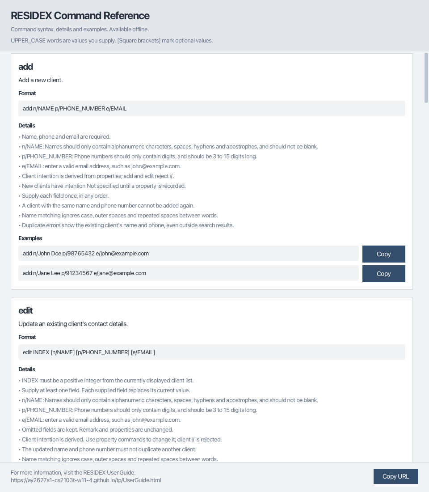

# RESIDEX User Guide

RESIDEX is a **desktop application for property agents managing buyers and sellers, optimized for use through a Command Line Interface (CLI)** while retaining the benefits of a Graphical User Interface (GUI). If you type quickly, RESIDEX can help you manage contacts faster than traditional GUI applications.

<!-- * Table of Contents -->
<page-nav-print />

--------------------------------------------------------------------------------------------------------------------

## Quick start

1. Ensure that Java `25` or later is installed on your computer. 
   **Mac users:** Ensure you have the precise JDK version prescribed [here](https://se-education.org/guides/tutorials/javaInstallationMac.html).

1. Download the latest `.jar` file from [here](https://github.com/AY2627S1-CS2103T-W11-4/tp/releases).

1. Copy the file to the folder you want to use as the _home folder_ for RESIDEX.

1. Open a terminal, `cd` to the folder containing the JAR file, and run `java -jar Residex.jar`. 
   A GUI similar to the one below should appear in a few seconds. Note how the app contains some sample data. 
   

1. Type a command in the command box and press Enter to execute it. For example, type **`help`** and press Enter to open the help window. 
   Some example commands you can try:

   * `list` : Lists all contacts.

   * `add n/John Doe p/98765432 e/johnd@example.com i/Buyer b/1500000` : Adds a buyer named `John Doe` with a budget of $1,500,000.

   * `delete 3` : Deletes the 3rd contact shown in the current list.

   * `exit` : Exits the app.

1. Refer to the [Features](#features) section below for details of each command.

--------------------------------------------------------------------------------------------------------------------

## Features

<box type="info" seamless>

**Notes about the command format:** 

* Command words are case-insensitive; `ADDP` and `addp` run the same command.
  Prefixes for property commands are also case-insensitive, while existing client commands retain their documented field rules.

* Words in `UPPER_CASE` are the parameters to be supplied by the user. 
  For example, in `add n/NAME`, replace `NAME` with a value such as `John Doe`.

* Items in square brackets are optional. 
  For example, `n/NAME [b/BUDGET]` can be used as `n/John Doe b/1500000` or as `n/John Doe`.

* Parameters can be in any order. 
  For example, if the command specifies `n/NAME p/PHONE_NUMBER`, `p/PHONE_NUMBER n/NAME` is also acceptable.

* Extraneous parameters for commands that take no parameters, such as `help`, `list`, and `exit`, are ignored. 
  For example, `help 123` is interpreted as `help`.

* If you are using a PDF version of this document, be careful when copying and pasting commands that span multiple lines as space characters surrounding line-breaks may be omitted when copied over to the application.
</box>

### Viewing help: `help`

Opens a separate, resizable window containing the command reference. Each command has a card showing its
purpose, format, parameter rules and examples. The command reference is available without an internet connection.

Format: `help`

* Scroll through the cards using the mouse wheel or scrollbar. Resize the window for more space.
* Examples are for reference only. Enter commands in the main application's command box to run them.
* You can also open help by pressing `F1` or selecting **Help > Help**. Opening help again focuses the existing window.
* Click **Copy URL** in the footer to copy the RESIDEX User Guide link for further information.
  Opening the online guide requires an internet connection.

### Adding a client: `add`

Adds a client to RESIDEX.

Format: `add n/NAME p/PHONE_NUMBER e/EMAIL i/INTENTION [b/BUDGET]`

A client is a duplicate only when both their name and phone number match an existing client.
Name matching ignores capitalisation, surrounding spaces and repeated spaces between words.
For example, `Alice Tan` and `ALICE   TAN` match when their phone numbers are the same.
Phone input is trimmed, then compared digit for digit, including leading zeros.
Clients may share a name if their phone numbers differ, or share a phone number if their names differ.
Different email addresses, intentions, budgets or remarks do not make an otherwise duplicate client distinct.
If an add or edit would create a duplicate, the error identifies the existing client's stored name and phone number and explains how names are matched.
The conflicting client may be outside the current search results.
A rejected command leaves all client information unchanged.

Intention is required and must be `Buyer` or `Seller` (case-sensitive). For example, use `i/Buyer`.
Existing `edit` and `remark` commands preserve intention; changing it through `edit` is not supported yet.

Budget is optional. It is a whole-dollar amount with no commas and no decimal point, such as `b/1500000`.
The client card shows that amount on the right.
$800,000 and below is red, above $800,000 up to $2,500,000 is yellow, and above $2,500,000 is green.
A saved file that has no budget still opens.

**Existing data:** Before using this version, back up `data/addressbook.json`. Each person needs an
`"intention": "Buyer"` or `"intention": "Seller"` property matching their actual intention.
Files with missing or invalid intentions cannot be loaded. RESIDEX will show an error and close until the file is fixed.
Saved files containing duplicate name-and-phone pairs under the rule above also cannot be loaded.
Back up the file and resolve these duplicates before opening it with this version.

Examples:
* `add n/John Doe p/98765432 e/johnd@example.com i/Buyer b/1500000`
* `add n/Betsy Crowe e/betsycrowe@example.com i/Seller p/1234567`

### Listing all clients: `list`

Shows a list of all clients in RESIDEX.

Format: `list`

### Editing a client: `edit`

Edits an existing client in RESIDEX.

Format: `edit INDEX [n/NAME] [p/PHONE] [e/EMAIL] [b/BUDGET]`

* Edits the person at the specified `INDEX`. The index refers to the index number shown in the displayed person list. The index **must be a positive integer** 1, 2, 3, ...
* At least one of the optional fields must be provided.
* Existing values will be updated to the input values.
* Client edits preserve all property entries.
  Use `editp` to change a property.
* `b/BUDGET` replaces the client's budget. Leaving `b/` out keeps the existing budget.
* The updated name and phone number must not match another client under the [duplicate-client rule](#adding-a-client-add).
  Changing only the capitalisation or spacing of the selected client's own name is allowed.

Examples:
*  `edit 1 p/91234567 e/johndoe@example.com` Edits the phone number and email address of the 1st person to be `91234567` and `johndoe@example.com` respectively.
*  `edit 1 b/900000` Sets the 1st person's budget to $900,000, shown in yellow.
*  `edit 2 n/Betsy Crower` Edits the name of the 2nd person to be `Betsy Crower`.

### Managing a client's properties

Each client can have an ordered list of properties, shown as numbered entries on their client card.
Each property has one type, one buying or selling intention, one location, and an optional price.
Property intentions and prices are independent of the client's intention and budget.

* `CLIENT_INDEX` selects a client in the currently displayed list, including search results.
* `PROPERTY_INDEX` selects a numbered property under that client, starting from 1.
* Property commands keep the current client filter.
* Identical property entries are allowed within one client and across clients.
  Each entry is independent; editing one does not change another client's entry.
* Property fields can be supplied in any order, once each.
  Prefixes, property types and property intentions are case-insensitive.
* Valid types are `HDB` (`h`), `Condominium` (`c`) and `Landed` (`l`).
  Valid property intentions are `Buyer` and `Seller`.
* Location is nonblank text, for example `Clementi Ave 3`.
  Surrounding whitespace is removed; capitalisation and internal spaces are preserved.
* `pr/PRICE` is the property's price in whole Singapore dollars, separate from `b/BUDGET` on the client.
  A supplied price must be positive, no greater than `9223372036854775807`, and contain no commas, decimals or leading zeros.
  Use `pr/` rather than `p/` for property prices.
* Whitespace-separated words ending in `/` are treated as field prefixes in property commands.
  Use only `t/`, `i/`, `l/` and `pr/`; do not include prefix-like text such as `MRT/Exit` in a location.

### Adding a property: `addp`

Format: `addp CLIENT_INDEX t/TYPE i/INTENTION l/LOCATION [pr/PRICE]`

Type, property intention and location are required.
Omit `pr/` if the price is unknown; a supplied empty `pr/` is rejected when adding.
The new property is appended to the selected client's list.

Examples:

* `addp 1 t/HDB i/Buyer l/Clementi pr/800000` adds a property with an $800,000 price to the first displayed client.
* `addp 1 t/c i/Seller l/Bishan` adds a condominium entry without a price to the same client.
* `ADDP 1 T/l I/buyer L/Bukit Timah PR/3200000` adds a landed property using mixed-case syntax.

### Deleting a property: `delp`

Format: `delp CLIENT_INDEX PROPERTY_INDEX`

Deletes only the selected property, leaving the client and their other information intact.
Later property entries shift down by one index.
Location is required, so deleting only a property's location is not supported.
Deletion has no undo command.

Example: `delp 1 2` deletes property 2 from the first displayed client.
The former property 3, if any, becomes property 2.

### Editing a property: `editp`

Format: `editp CLIENT_INDEX PROPERTY_INDEX [t/TYPE] [i/INTENTION] [l/LOCATION] [pr/PRICE]`

* Supply at least one field.
  Omitted fields keep their current values.
* Empty `pr/` removes the optional price.
  Empty `t/`, `i/` and `l/` are rejected.
* All supplied values and both indexes are checked before anything changes.
  Invalid input leaves the original property unchanged.
* An edit that produces the same stored values reports that the property is unchanged.
* Editing a property keeps its position and does not change other properties, client details or the client's budget.

Examples:

* `editp 1 2 l/Toa Payoh` changes only property 2's location for the first displayed client.
* `editp 1 2 t/Landed i/Seller pr/3200000` changes its type, property intention and price together.
* `editp 1 2 pr/` removes its price while preserving its location and other fields.

### Locating persons by name, email, phone, location, or intention: `find`

Finds contacts using exactly one selected search field.

Format: `find FIELD/KEYWORD [MORE_KEYWORDS]`

Search field | Prefix
--- | ---
Name | `n/`
Email | `e/`
Phone | `p/`
Property location | `l/`
Intention | `i/`

* Prefix letters and keywords are case-insensitive; `N/` and `n/` have the same effect.
* Specify exactly one short prefix immediately after `find`, with `/` immediately after the letter.
  Missing, unknown, repeated, or mixed prefixes are rejected. For example, use `find n/alice`.
  Long search field aliases are not supported.
* At least one keyword is required. Extra whitespace is ignored, and keyword order does not matter.
* Name, email, phone, and location searches use substring matching; `find n/ali` matches `Alice`.
* Multiple keywords use `OR` matching: a contact is returned if any keyword matches the selected search field.
* Location searches check all property entries attached to each client. A client appears once if any location matches;
  clients without property entries do not match. Enter keywords without quotation marks.
* Spaces separate location keywords. A multiword location search matches any of its keywords independently;
  it does not search for the whole phrase or require an exact address match.
* Intention searches require exactly one complete value: `buyer` or `seller`, in any capitalization.
* Only the selected search field is searched. Each search filters the entire contact list, replacing any previous filter.
  Use `list` to show all contacts again. Searches do not modify stored contacts.

Examples:

* `find n/alice` finds names containing `alice`.
* `find n/alex david` returns `Alex Yeoh` and `David Li`.
* `find e/gmail` finds email addresses containing `gmail`.
* `find p/9123` finds phone numbers containing `9123`.
* `find l/clementi` finds clients with locations such as `Clementi Ave 3` or `Woodlands Clementi`.
* `find l/clementi woodlands` finds clients with any property location containing `clementi` or `woodlands`.
* `find l/Clementi Ave 3` searches for `Clementi`, `Ave`, or `3` independently. It matches locations such as
  `Clementi Ave 3`, `Woodlands Clementi`, `Bedok Ave 1`, and `Tampines Street 3`.
* `find i/buyer` lists all buyers.
* `find i/seller` lists all sellers.

### Deleting a client: `delete`

Deletes the specified client from RESIDEX.

Format: `delete INDEX`

* Deletes the person at the specified `INDEX`.
* The index refers to the index number shown in the displayed person list.
* The index **must be a positive integer** 1, 2, 3, ...

Examples:
* `list` followed by `delete 2` deletes the 2nd client in RESIDEX.
* `find n/Betsy` followed by `delete 1` deletes the 1st person in the results of the `find` command.

### Setting or removing a remark: `remark`

Sets or removes a client's remark.

Format: `remark INDEX r/[REMARK]`

* `INDEX` is a positive integer referring to the client in the currently displayed list, including search results.
* The supplied remark replaces the existing remark. Enter `r/` without text to remove it.
* Contact details, intention, budget and properties are kept.

Examples:

* `remark 1 r/Call next week` replaces the first displayed client's remark with `Call next week`.
* `remark 1 r/` removes the first displayed client's remark.

### Exiting the program: `exit`

Exits the program.

Format: `exit`

### Saving the data

RESIDEX automatically saves data after every command. You do not need to save manually.

### Editing the data file

RESIDEX data is saved automatically as a JSON file `[JAR file location]/data/addressbook.json`. Advanced users are welcome to update data directly by editing that data file.

<box type="warning" seamless>

**Caution:**
If your changes make the data file invalid, RESIDEX shows an error with the file's location and closes without changing the client data file. Back up the file before editing it. 
Furthermore, certain edits can cause RESIDEX to behave in unexpected ways (e.g., if a value entered is outside of the acceptable range). Therefore, edit the data file only if you are confident that you can update it correctly.
</box>

### Recovering from a data loading error

If RESIDEX cannot load an existing client data file, it shows an error and closes. Commands and automatic saving are unavailable, so the failed file cannot be overwritten by an empty client list.

1. Locate the file using the path shown in the error dialog and make a backup copy.
2. Repair the invalid data or replace the file with a valid backup, then restart RESIDEX.
3. If you want to start fresh instead, move or rename the failed file before restarting. RESIDEX will start with sample clients, as it does when no data file exists. Keep the original file if you want to recover its contents later.

### Archiving data files `[coming in v2.0]`

_Details coming soon ..._

--------------------------------------------------------------------------------------------------------------------

## FAQ

**Q**: How do I transfer my data to another computer? 
**A**: Install the app on the other computer and overwrite the data file it creates with the data file from your previous RESIDEX home folder.

--------------------------------------------------------------------------------------------------------------------

## Known issues

1. **When using multiple screens**, if you move the application to a secondary screen, and later switch to using only the primary screen, the GUI will open off-screen. The remedy is to delete the `preferences.json` file created by the application before running the application again.
2. **If you minimize the Help Window** and then run the `help` command (or use the `Help` menu, or the keyboard shortcut `F1`) again, the original Help Window will remain minimized, and no new Help Window will appear. The remedy is to manually restore the minimized Help Window.

--------------------------------------------------------------------------------------------------------------------

## Command summary

Action     | Format, Examples
-----------|----------------------------------------------------------------------------------------------------------------------------------------------------------------------
**Add**    | `add n/NAME p/PHONE_NUMBER e/EMAIL i/INTENTION [b/BUDGET]`   e.g., `add n/James Ho p/22224444 e/jamesho@example.com i/Buyer b/1500000`
**Delete** | `delete INDEX`  e.g., `delete 3`
**Edit**   | `edit INDEX [n/NAME] [p/PHONE_NUMBER] [e/EMAIL] [b/BUDGET]`  e.g., `edit 2 n/James Lee e/jameslee@example.com`
**Add property** | `addp CLIENT_INDEX t/TYPE i/INTENTION l/LOCATION [pr/PRICE]`  e.g., `addp 1 t/HDB i/Buyer l/Clementi pr/800000`
**Delete property** | `delp CLIENT_INDEX PROPERTY_INDEX`  e.g., `delp 1 2`
**Edit property** | `editp CLIENT_INDEX PROPERTY_INDEX [t/TYPE] [i/INTENTION] [l/LOCATION] [pr/PRICE]`  e.g., `editp 1 2 l/Toa Payoh`
**Find**   | `find FIELD/KEYWORD [MORE_KEYWORDS]`  e.g., `find n/James Jake`, `find e/gmail`, `find p/9123`, `find l/clementi`, `find i/seller`
**List**   | `list`
**Remark** | `remark INDEX r/[REMARK]`  e.g., `remark 1 r/Call next week`
**Help**   | `help`
